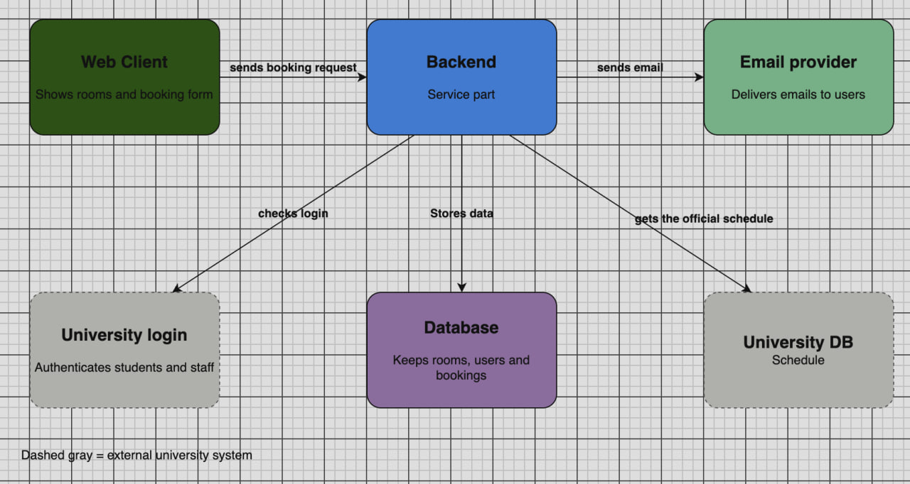

# room-booking
App lets students book empty rooms safely while locking taken slots. Professors can also schedule lectures. Built with Spring Boot and PostgreSQL.

## Team
Name                 |       Contributions

Turgunbay Meiirbek   |   container diagram, repository setup: readme, maven and spring boot configuration(pom.xml)

Daulet Aladi         |   Architecture choice:one selected style and one rejected alternative

Jubanissov Daniyar   |  ADR 1: context, decision, alternatives, consequences


# container diagram:



## Repository structure

```
room-booking/
├── src/            # Spring Boot code
├── pom.xml
└── README.md
```

# how to run
Instructions will be added after the first working version.
Requirements: Java 21, Maven.


