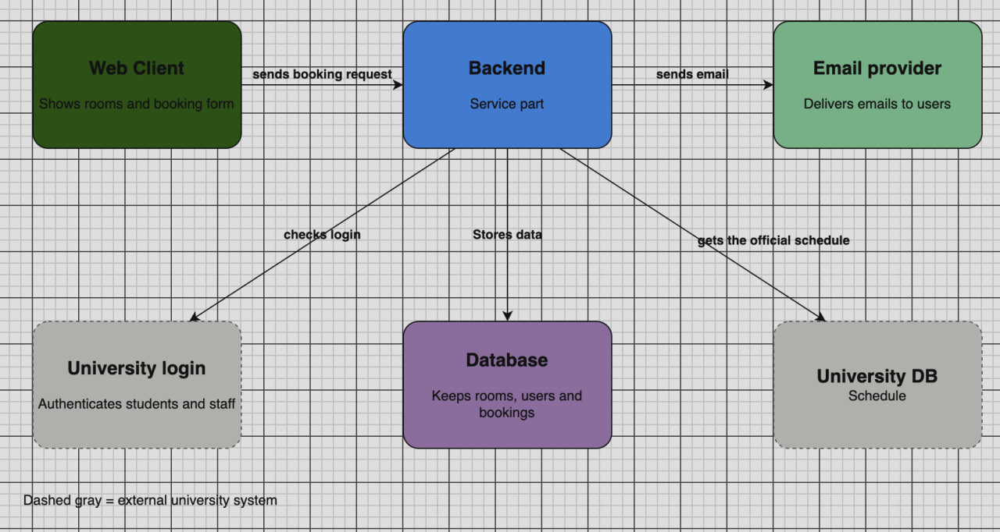

# room-booking
App lets students book empty rooms safely while locking taken slots. Professors can also schedule lectures. Built with Spring Boot and PostgreSQL.

## Team
Name                 |       ID

Turgunbay Meiirbek   |   240107022

Daulet Aladi         |   240107102

Jubanissov Daniyar   |   240107038


# Container diagram:



# Architecture style
The architecture we are using is Layered Modular Monolith. The Layered architecture was chosen due to the fixed order of access flow, and Modular Monolith architecture was added since some layers have to consist of several modules, hence the combination of the 2.

# Architecture Decision Record (ADR #1): Asynchronous Email Notifications

### 1. Context

Email delivery may be delayed or temporarily unavailable. Booking submissions and approval decisions should remain responsive even when notifications cannot be delivered immediately.

---

### 2. Decision

The system will process email notifications asynchronously after a booking request is submitted, approved, or rejected, allowing booking and approval operations to complete without waiting for email delivery.

---

### 3. Alternatives Considered

Send email notifications synchronously as part of the booking or approval operation. This would avoid the need to manage a queue of pending notifications, but slow email delivery would still delay the booking response.

---

### 4. Consequences

Booking and approval operations can complete without waiting for email delivery. The system must track pending notifications and handle delivery failures or delays.


# Architecture Decision Record (ADR #2): Automatic Booking Request Approval

### 1. Context

Booking requests require a mechanism to determine when a room reservation should be confirmed. Manual approval would require staff involvement and introduce additional delays. The system instead uses contributions from other students to determine whether a booking request should be accepted.

---

### 2. Decision

A booking request will be automatically approved once it receives five contributions. Until that threshold is reached, the request remains pending and continues accepting contributions. Once approved, further contributions will no longer be accepted, and the corresponding room slot will be marked as unavailable. The existing requests for this slot will be rejected.

---

### 3. Alternatives Considered

Require university staff to manually review and approve each booking request. This would provide additional administrative control but introduce processing delays and require staff involvement.
Approve booking requests immediately after submission. This would simplify the booking process but eliminate the contribution-based acceptance mechanism.

---

### 4. Consequences

The approval process becomes automated, reducing the need for administrative involvement. Booking status transitions can be handled by the application based on contribution counts.
The system must ensure that contribution counts are updated consistently and that simultaneous contributions cannot cause incorrect approval decisions. Room availability must also be updated when a request is approved.


## Repository structure

```
room-booking/
├──room-booking-application/
│  ├── src/            # Spring Boot code
│  └── pom.xml
├── .gitattributes
├── .gitignore
└── README.md
```

# Setup
Any IDE with Java 21 and Maven, PostgreSQL 18

# How to run
1) Create a Database "room-booking" in pgAdmin 4 using PostgreSQL.
2) Go into Query Tools for the database.
3) Open sql/data.sql in Query Tools.
4) Press F5 to execute it.
5) Open and run room-booking-application/src/main/java/kz/sdu/roombooking/RoomBookingApplication.java
6) Open localhost:8080 on a browser, and you are on the webservice

